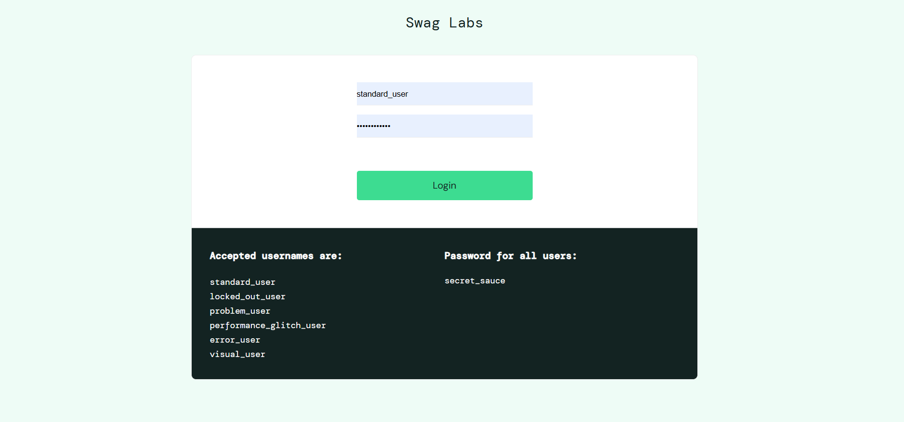
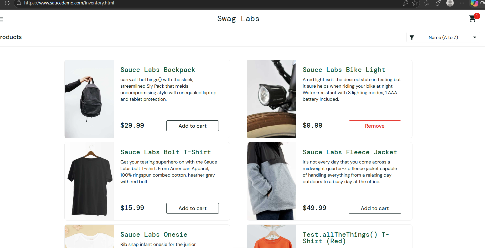
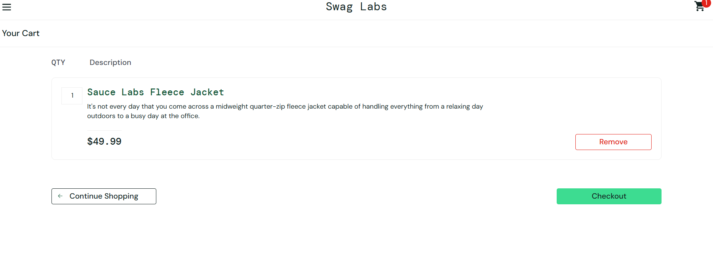
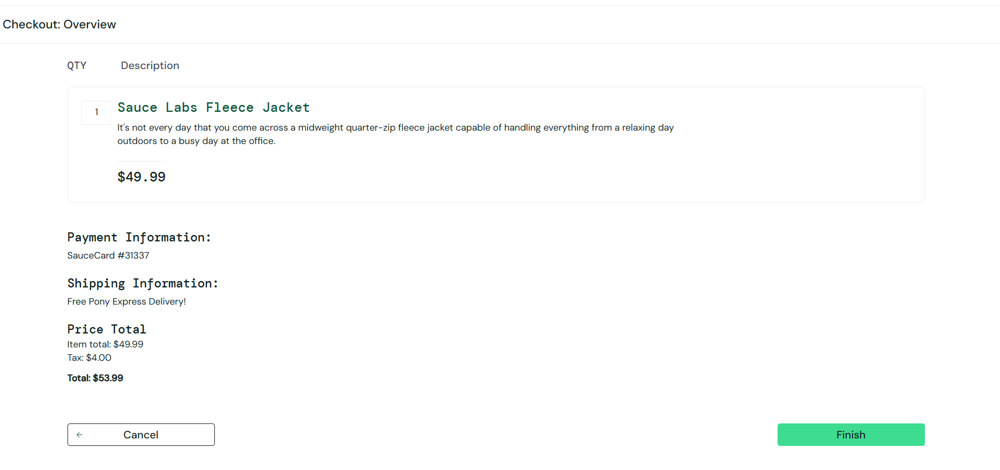

 SauceDemo – Manual Testing Project

Project Overview
This project focuses on manual testing of the SauceDemo e-commerce website. The objective is to verify the functionality of the application and identify potential defects through manual testing.

 Application Under Test
- Website: https://www.saucedemo.com/
- Testing Type: Manual Testing
- Testing Tool: Microsoft Excel
- Browser: Google Chrome

 Testing Modules
1. Login Module
2. Product Module
3. Cart Module
4. Checkout Module
5. Logout Module

 Test Execution Summary
- Total Test Cases: 30
- Test Cases Passed: 30
- Test Cases Failed: 0
- Test Cases Pending: 0

Testing Activities
- Functional Testing
- Positive Testing
- Negative Testing
- Form Validation Testing
- Cart Functionality Testing
- Checkout Testing
- Logout Testing

 Test Data
- Username: standard_user
- Password: secret_sauce

 Project Files
- SauceDemo_Test_Cases.xlsx – Test cases and execution results.

 My Learning
Through this project, I gained practical experience in writing test cases, executing test scenarios, validating application functionality, and documenting test results.

 Author
Manual QA Testing Fresher

## Screenshots

### 1. Login Page

### 2. Products Page

### 3. Cart Page

### 4. Checkout Page

### 5. Order Confirmation Page

